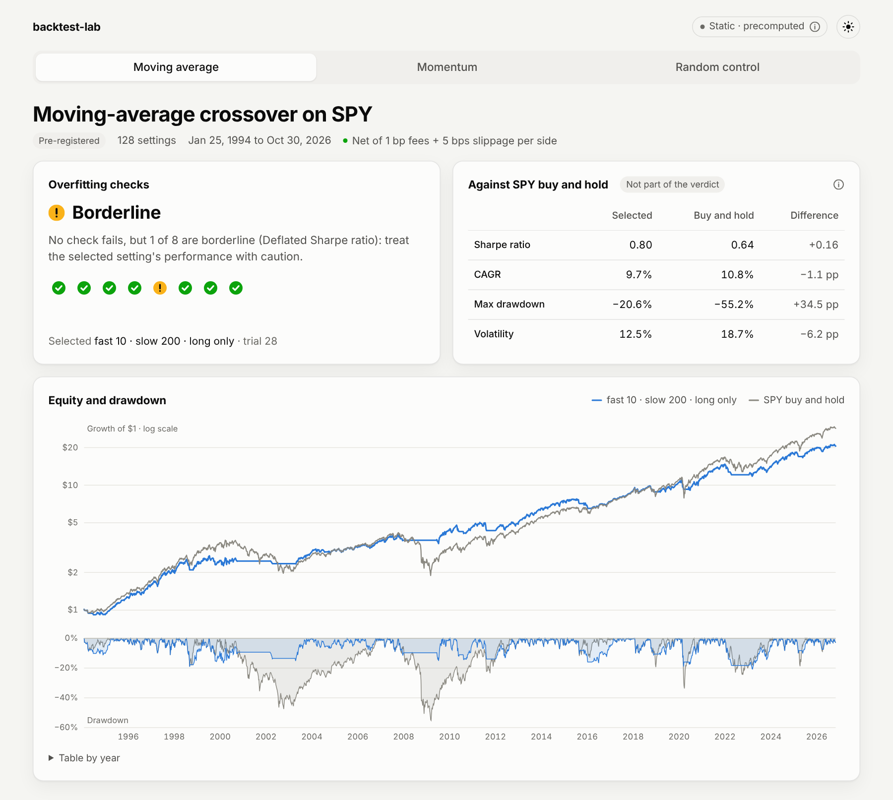

# backtest-lab

A backtesting platform that tests whether a strategy is probably overfit: it runs a parameter search, then judges the winner with walk-forward analysis, purged cross-validation, the probability of backtest overfitting (PBO) and the deflated Sharpe ratio (DSR).

**Dashboard: [shyanorn.github.io/backtest-lab](https://shyanorn.github.io/backtest-lab/)**

## Pre-registered results

Three searches on SPY from 1993 to October 2026, fixed before any strategy was run on real data ([D021](docs/DECISIONS.md#d021-pre-registered-demo)) and run once. Returns are net of 1 bp fees and 5 bps slippage per side; Sharpe ratios are annualized.

| Search | Trials | Selected setting | Sharpe, selected / buy and hold | Overfitting checks |
|---|---|---|---|---|
| Moving-average crossover | 128 | fast 10, slow 200, long only | 0.80 / 0.64 | Borderline: DSR 0.945, just below 0.95 |
| Time-series momentum | 34 | lookback 273, long only | 0.79 / 0.65 | Borderline: PBO 0.12, above 0.10 |
| Random-signal control | 100 | seed 55 | 0.23 / 0.64 | Fail on 6 of 8 checks |



- A search with no skill still finds a winner with a positive Sharpe ratio; the checks fail it.
- For both real strategies, the main finding of the search is that long only beats long/short on SPY, which keeps their PBO low. Within the long-only settings, picking the best is close to a coin flip (PBO 0.42 and 0.72, post hoc).
- The moving average has a higher Sharpe ratio than buy and hold because its drawdowns are smaller (−21% against −55%); its CAGR is lower (9.7% against 10.8%).

Passing the overfitting checks says a result is unlikely to come from the search alone. Whether it beats the market is a separate question, and each report answers the two apart. [DEMO.md](docs/DEMO.md) has every check and the post hoc analysis, labelled as such; [the notebook](notebooks/demo.ipynb) recomputes the figures from the frozen reports.

## Methods

| Check | Question | Reference |
|---|---|---|
| [Holdout split](docs/METHODS.md#21-holdout-split) | Does out-of-sample performance fall apart? | |
| [Walk-forward analysis](docs/METHODS.md#22-walk-forward-analysis) | With the setting re-picked every year, how does the next year go? | Pardo (2008) |
| [Purged cross-validation](docs/METHODS.md#3-purged-and-embargoed-k-fold-cross-validation) | Does the pick hold on held-out folds once overlapping days are removed? | López de Prado (2018) |
| [PBO](docs/METHODS.md#4-combinatorially-symmetric-cross-validation-cscv-and-the-probability-of-backtest-overfitting-pbo) | How often does the in-sample winner rank in the bottom half out of sample? | Bailey, Borwein, López de Prado & Zhu (2017) |
| [Deflated Sharpe ratio](docs/METHODS.md#5-deflated-sharpe-ratio-dsr) | Is the Sharpe ratio significant given how many settings were tried? | Bailey & López de Prado (2014) |
| [Probabilistic Sharpe ratio](docs/METHODS.md#6-probabilistic-sharpe-ratio-psr-minimum-track-record-length-mintrl-and-minimum-backtest-length-minbtl) | Is it above zero, ignoring the search? | Bailey & López de Prado (2012) |
| [Minimum backtest length](docs/METHODS.md#6-probabilistic-sharpe-ratio-psr-minimum-track-record-length-mintrl-and-minimum-backtest-length-minbtl) | Is the history long enough for that many trials? | Bailey, Borwein, López de Prado & Zhu (2014) |
| [Parameter sensitivity](docs/METHODS.md#7-parameter-sensitivity) | Do neighbouring settings keep the Sharpe ratio? | |

Verdict thresholds were fixed in advance ([D022](docs/DECISIONS.md#d022-credibility-report-verdicts)); the report format is in [REPORT.md](docs/REPORT.md).

## Run it locally

Needs [uv](https://docs.astral.sh/uv/) and Node 22.

```bash
uv sync
uv run python -m backtest_lab.data.update            # prices and macro data into data/, not committed
uv run uvicorn backtest_lab.api.main:app --host 127.0.0.1
cd web && npm ci && npm run dev                      # http://localhost:5173
```

With the API running, the dashboard adds a Custom sweep view that runs a parameter search and renders its report. The API has no authentication, so keep it on 127.0.0.1 ([D016](docs/DECISIONS.md#d016-api-scope-and-data)). Without it, the dashboard shows the committed results, as the public site does.

The registered results in `results/demo/` are not regenerated ([D042](docs/DECISIONS.md#d042-the-demo-results-stay-frozen-the-weekly-workflow-only-updates-data)). To rerun the searches into another directory:

```bash
uv run python -m backtest_lab.validation.demo --out /tmp/rerun
```

Tests and checks:

```bash
uv sync --group notebook
uv run pytest
uv run ruff check . && uv run mypy
uv run python notebooks/run.py --check
cd web && npm test && npm run build
npx playwright install chromium && npm run e2e
```

## Layout

```
src/backtest_lab/
  data/        Fetching, cleaning, Parquet storage and quality checks
  engine/      Vectorized backtest engine, costs and metrics
  strategies/  Example strategies
  validation/  Parameter search and the overfitting checks
  api/         FastAPI service for local sweeps
web/           React dashboard
notebooks/     The registered demo, recomputed
results/       Registered and post hoc reports
docs/          Specification, methods, decisions, report format
```

## Limitations

- The demo trades SPY only. The individual stocks in the data were chosen because they exist today, which is survivorship bias ([D009](docs/DECISIONS.md#d009-instrument-universe)).
- Cash earns nothing and shorts pay no borrow fee ([D015](docs/DECISIONS.md#d015-cash-shorting-and-leverage)).
- Macro data is the latest revised vintage ([D010](docs/DECISIONS.md#d010-macro-publication-lag-and-revisions)).

## Disclaimer

For research and education only. Not investment advice.

## License

MIT
