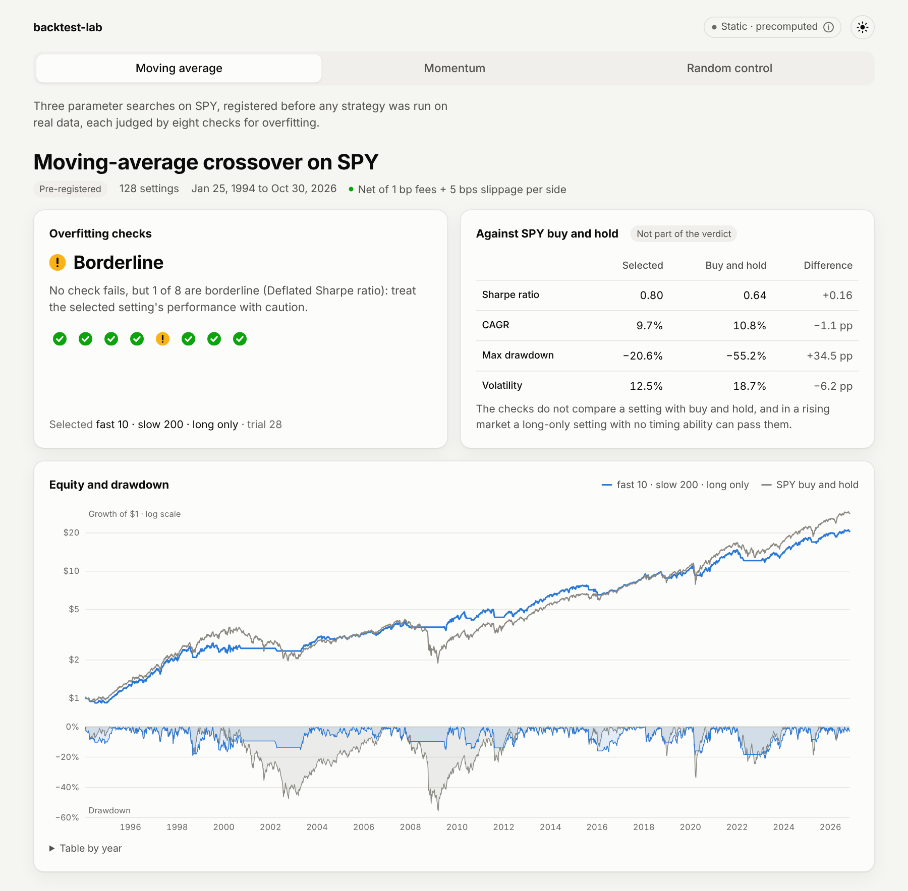

# backtest-lab

[](https://github.com/sHyanorn/backtest-lab/actions/workflows/ci.yml?query=branch%3Amain)

A backtesting platform that tests whether a strategy is probably overfit. It runs a parameter search, then judges the winner with eight checks, among them walk-forward analysis, purged cross-validation, the probability of backtest overfitting (PBO) and the deflated Sharpe ratio (DSR). In three searches on SPY, registered before any strategy was run on real data, a random-signal control still found a winner with a positive Sharpe ratio, and it failed 6 of 8 checks, one of them sensitivity, which is uninformative for seeds. The moving-average and momentum searches came out borderline. The checks do not test timing ability, and none tests whether a result beats buy and hold. A separate study, registered in D043, tests both grids against buy and hold on samples they never saw.

**Dashboard: [shyanorn.github.io/backtest-lab](https://shyanorn.github.io/backtest-lab/)**

## Results

### Registered searches on SPY

Three searches on SPY from 1993 to October 2026, fixed before any strategy was run on real data ([D021](docs/DECISIONS.md#d021-pre-registered-demo)). The reports come from a single run. Returns are net of 1 bp fees and 5 bps slippage per side; Sharpe ratios are annualized.

| Search | Trials (independent, two estimates) | Selected setting | Sharpe, selected / buy and hold | Overfitting checks |
|---|---|---|---|---|
| Moving-average crossover | 128 (47.9, 72.6) | fast 10, slow 200, long only | 0.80 / 0.64 | Borderline: DSR 0.945, just below 0.95 |
| Time-series momentum | 34 (14.0, 20.2) | lookback 273, long only | 0.79 / 0.65 | Borderline: PBO 0.12, above 0.10 |
| Random-signal control | 100 (100.0, 99.7) | seed 55 | 0.23 / 0.64 | Fail on 6 of 8 checks, one of them sensitivity, which is uninformative for seeds |



- Post hoc: for both real strategies, the main finding of the search is that long only beats long/short on SPY, which keeps their registered PBO well below 0.5. Within the long-only settings, picking the best is not shown to beat picking at random: PBO is 0.42 and 0.72, where searches with no skill averaged 0.488 with a standard deviation of 0.153 in the calibration of [D022](docs/DECISIONS.md#d022-credibility-report-verdicts), which used 100 trials.
- The moving average has a higher Sharpe ratio than buy and hold because its volatility is lower (12.5% against 18.7%). Its maximum drawdown is smaller (−21% against −55%) and its CAGR is lower (9.7% against 10.8%).
- Post hoc: the registered reports estimate the independent trials from the average correlation, the first figure in the table. The second, from the eigenvalues of the correlation matrix, was added afterwards ([D041](docs/DECISIONS.md#d041-two-estimates-of-the-independent-trials-and-a-floor-of-ten)); new reports use the larger of the two. With it the deflated Sharpe ratios are 0.919, 0.979 and 0.147, and every verdict stays as registered.

[DEMO.md](docs/DEMO.md) has every check, the selected settings against buy and hold, and the post hoc analysis, labelled as such. [The notebook](notebooks/demo.ipynb) re-derives each report's statistics from the inputs stored in it and applies the thresholds again.

### Tests against buy and hold

On the US market from 1926 to 1993, no setting of either grid is shown to beat buy and hold in Sharpe ratio or in mean return after correcting for the grids and for the 4 families (smallest Holm-adjusted p 1.0). On the eight ETFs, no setting of either grid is shown to beat buy and hold in Sharpe ratio or in mean return after correcting for the grids and for the 32 families (smallest Holm-adjusted p 0.928).

| Question | Families | Smallest Holm-adjusted p-value | Smallest p-value before Holm | Findings |
|---|---|---|---|---|
| US market, 1926 to 1993 | 4 | 1.0 | 0.6826 (moving average, Sharpe ratio) | 0 |
| Eight ETFs | 32 | 0.928 | 0.029 (SHY, momentum, Sharpe ratio) | 0 |

- Limit: D043 estimated, for orientation only, that a finding needs an annualized Sharpe difference of about 0.25 to 0.28 on the US market and 0.45 to 0.55 on an ETF for a long-only setting whose daily returns correlate about 0.8 with buy and hold and with independent returns, so smaller true differences are unlikely to be found.
- Limit: the ETFs cover SPY's years, and the grids hold conventional values, such as a 200-day average, whose popularity owes something to long US histories that include 1926 to 1993 (D043).
- Interpretation: the best settings' annualized Sharpe differences, 0.07 on the US market and at most 0.26 on an ETF (SHY, momentum), are below the sizes D043 estimated a finding needs.
- Post hoc: SPY over D021's sample was known before D043 and was rerun with D043's code. The smallest p-value of its 4 families is 0.3934 (momentum, Sharpe ratio). D021's two selected settings, tested alone, have p-values of 0.1065 (moving average) and 0.1158 (momentum) on the Sharpe ratio and 1.0 for both on the mean return.

[DEMO.md](docs/DEMO.md#tests-against-buy-and-hold) has every family, the variants reported beside the decision (other costs, block lengths and subperiods) and how to rerun the study.

## How it works

A parameter search runs every setting of a strategy's grid through a vectorized engine with costs. The selected setting is then judged by eight checks: a holdout split, walk-forward analysis, purged cross-validation, PBO, the deflated and probabilistic Sharpe ratios, the minimum backtest length and parameter sensitivity. [METHODS.md](docs/METHODS.md) gives each check's formula and source. Verdict thresholds were fixed in advance ([D022](docs/DECISIONS.md#d022-credibility-report-verdicts)). Pass, borderline and fail are the green, yellow and red verdicts of the reports, whose format is in [REPORT.md](docs/REPORT.md).

The tests against buy and hold were registered in [D043](docs/DECISIONS.md#d043-registered-tests-against-buy-and-hold-on-samples-the-grids-never-saw) before any strategy was run on these samples. They compare every setting of both grids with buy and hold of the same instrument on data the grids never saw: the value-weighted US stock market from 1926 to 1993, at 84 bps per side, and QQQ, IWM, EFA, EEM, TLT, IEF, SHY and GLD from their first bar to October 2026, at 6 bps per side. A family is one sample, one grid and one criterion. A finding needs a Holm-adjusted SPA consistent p-value of at most 0.05 ([METHODS.md](docs/METHODS.md#8-data-snooping-tests-against-a-benchmark-reality-check-spa-and-stepm)); [DEMO.md](docs/DEMO.md#tests-against-buy-and-hold) gives the samples, costs and tests in full.

## Run it

Needs [uv](https://docs.astral.sh/uv/) and Node 22.12 or later. The API and the dev server each keep a terminal busy.

```bash
uv sync
uv run python -m backtest_lab.data.update            # prices and macro data into data/, not committed
uv run uvicorn backtest_lab.api.main:app --host 127.0.0.1
cd web && npm ci && npm run dev                      # http://localhost:5173
```

With the API running, the dashboard adds a Custom sweep view that runs a parameter search and renders its report. Without it, the dashboard shows the committed results, as the public site does. The registered results in `results/demo/` are not regenerated ([D032](docs/DECISIONS.md#d032-the-demo-results-stay-frozen-the-weekly-workflow-only-updates-data)); to rerun the searches into another directory:

```bash
uv run python -m backtest_lab.validation.demo --out /tmp/rerun
```

Tests and checks:

```bash
uv sync --group notebook
uv run pytest
uv run ruff check . && uv run mypy
uv run python notebooks/run.py --check
cd web && npm test && npm run build
npx playwright install chromium && npm run e2e
```

## Limits

- Passing the overfitting checks says the selected Sharpe ratio is above zero and unlikely to be a product of the search alone. In a market that rose over the sample, a long-only setting with no timing ability often comes out borderline or passing.
- Whether a result beats buy and hold is a separate question that no check tests. Each report shows that comparison as descriptive figures, outside the verdict.
- The momentum search is a simplified time-series momentum: fully long after a positive trailing total return and short or flat after a negative one, decided every day, without the volatility scaling, excess returns and monthly rebalancing of Moskowitz, Ooi & Pedersen (2012).
- The tests against buy and hold are unlikely to find small true differences; their two limits are stated with the results above.
- The demo trades SPY only. The individual stocks in the data were chosen because they exist today: survivorship bias ([D009](docs/DECISIONS.md#d009-instrument-universe)).
- Cash earns nothing and shorts pay no borrow fee ([D015](docs/DECISIONS.md#d015-cash-shorting-and-leverage)).
- Macro data is the latest revised vintage ([D010](docs/DECISIONS.md#d010-macro-publication-lag-and-revisions)).
- The API has no authentication, so keep it on 127.0.0.1 ([D016](docs/DECISIONS.md#d016-api-scope-and-data)).

For research and education only. Not investment advice.

## Layout

`src/backtest_lab/` holds the data pipeline, the vectorized engine with costs and metrics, the example strategies, the parameter search with the overfitting checks, and a FastAPI service for local sweeps. `web/` is the React dashboard, `notebooks/` recomputes the registered demo, `results/` holds the registered and post hoc reports, and `docs/` the specification, methods, decisions and report format.

MIT licence.
